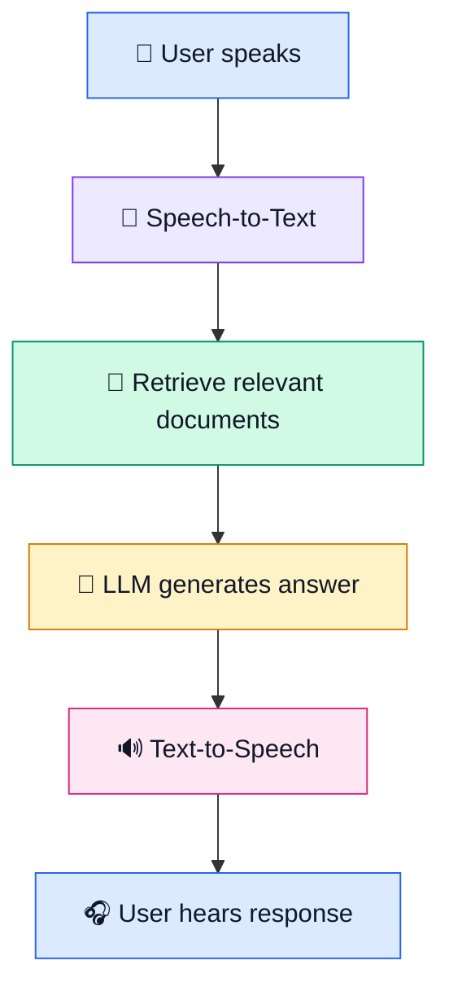
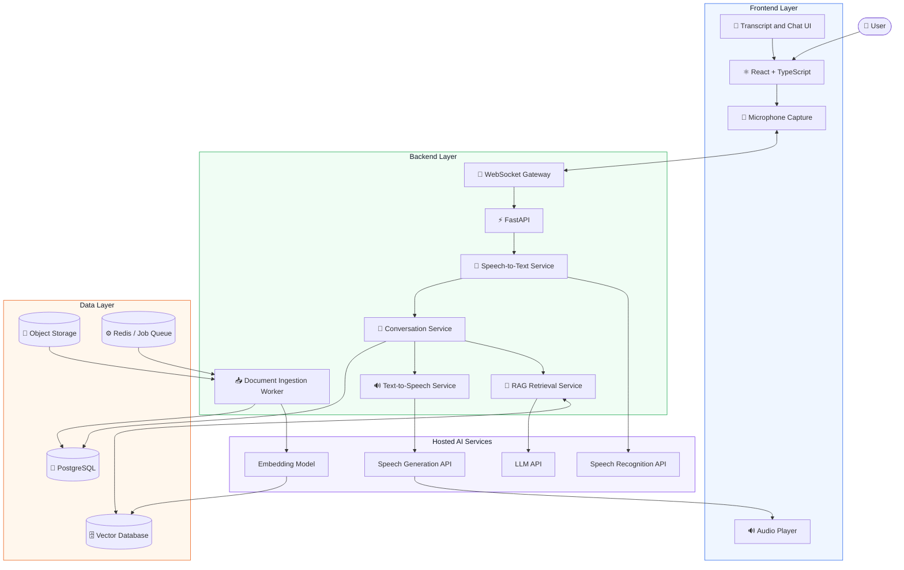
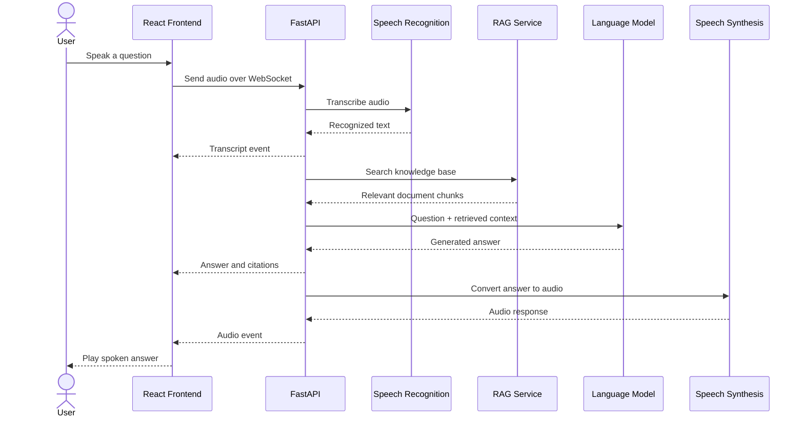
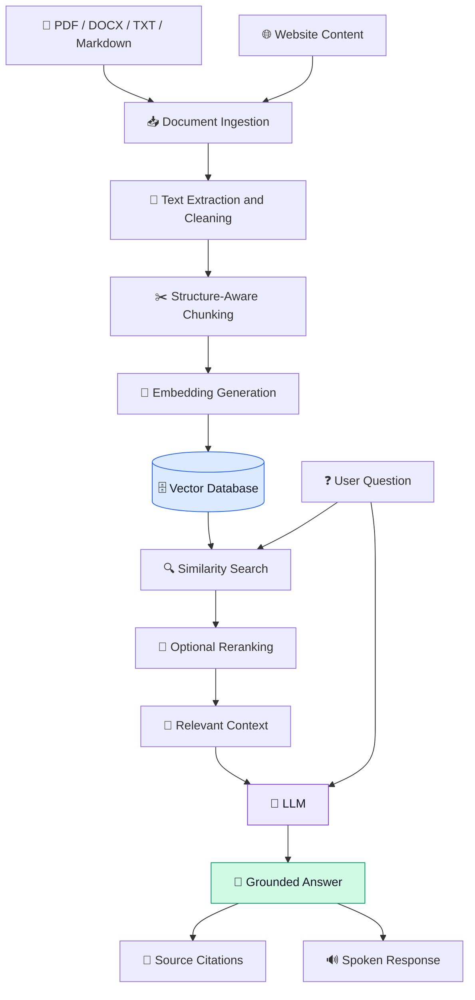
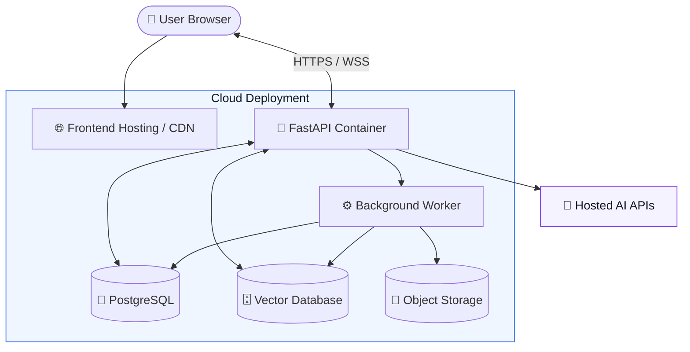

<div align="center">

# 🎙️ AI Voice Assistant with RAG

### Speak naturally. Ask questions. Get intelligent spoken answers.

A real-time AI voice assistant powered by React, FastAPI, speech recognition, Retrieval-Augmented Generation (RAG), and text-to-speech.

<p>
  
  
  
  
  
</p>

</div>

---

## 📌 Table of Contents

- [Overview](#-overview)
- [Features](#-features)
- [System Architecture](#-system-architecture)
- [Conversation Workflow](#-conversation-workflow)
- [RAG Pipeline](#-rag-pipeline)
- [Technology Stack](#-technology-stack)
- [Project Structure](#-project-structure)
- [Installation](#-installation)
- [Environment Configuration](#-environment-configuration)
- [Run the Application](#-run-the-application)
- [API Endpoints](#-api-endpoints)
- [Deployment Architecture](#-deployment-architecture)
- [Security](#-security)
- [Roadmap](#-roadmap)

---

## 🚀 Overview

The AI Voice Assistant allows users to interact with an AI system using natural speech.

The assistant transcribes speech into text, searches a knowledge base for relevant information, generates a grounded response, and converts that response into spoken audio.

It supports multiple knowledge sources while keeping document retrieval under your control.

### 💡 How it works



---

## ✨ Features

| Feature | Description |
|---|---|
| 🎤 Voice Input | Capture microphone audio |
| 📝 Speech-to-Text | Convert speech into text |
| 🧠 AI Responses | Generate contextual answers using an LLM |
| 📚 RAG | Retrieve relevant information from your knowledge base |
| 🔊 Text-to-Speech | Speak generated answers aloud |
| ⚡ Real-Time Transport | WebSocket communication and streaming-ready design |
| 📄 Document Ingestion | Index PDF, TXT, Markdown, and DOCX files |
| 🌐 Website Ingestion | Extract text from permitted public websites |
| 🔍 Semantic Search | Search knowledge using vector embeddings |
| 💬 Conversation History | Maintain conversation context |
| 🐳 Hybrid Deployment | Host the frontend, backend, and AI services independently |

---

## 🏗️ System Architecture



> **Architecture note:** This diagram represents the target architecture. A prototype can start with FastAPI, ChromaDB, local document storage, and hosted speech/LLM APIs. PostgreSQL, Redis, object storage, and dedicated workers can be introduced as requirements grow.

---

## 🔄 Conversation Workflow



### ⚡ Real-time design goals

- Send audio frames over a persistent connection.
- Use voice activity detection to identify turn boundaries.
- Display partial transcripts when supported.
- Stream generated audio rather than waiting for a complete file.
- Support interruption and cancellation of speech playback.
- Keep expensive document indexing outside the interactive voice request.

The initial implementation may process complete recordings per turn. Full streaming requires additional backend and frontend work.

---

## 📚 RAG Pipeline

Retrieval-Augmented Generation grounds answers in information from your own documents.



### RAG capabilities

- Semantic similarity search
- Chunk metadata and source tracking
- Retrieval relevance thresholds
- Optional reranking
- Citation-aware responses
- Document re-indexing
- Background ingestion jobs

**Important:** Retrieved text should be treated as untrusted content. The model should not follow instructions found inside uploaded documents.

---

## 🧰 Technology Stack

<table>
  <tr>
    <th>Layer</th>
    <th>Technology</th>
    <th>Purpose</th>
  </tr>
  <tr>
    <td>Frontend</td>
    <td>React + TypeScript</td>
    <td>Interactive voice interface</td>
  </tr>
  <tr>
    <td>Styling</td>
    <td>Tailwind CSS</td>
    <td>Responsive UI</td>
  </tr>
  <tr>
    <td>Backend</td>
    <td>FastAPI</td>
    <td>API and service orchestration</td>
  </tr>
  <tr>
    <td>Real-time</td>
    <td>WebSocket</td>
    <td>Voice event transport</td>
  </tr>
  <tr>
    <td>STT</td>
    <td>Hosted transcription API</td>
    <td>Speech recognition</td>
  </tr>
  <tr>
    <td>LLM</td>
    <td>Hosted language model</td>
    <td>Answer generation</td>
  </tr>
  <tr>
    <td>TTS</td>
    <td>Hosted speech API</td>
    <td>Audio generation</td>
  </tr>
  <tr>
    <td>Embeddings</td>
    <td>Sentence Transformers</td>
    <td>Text vectorization</td>
  </tr>
  <tr>
    <td>Vector Search</td>
    <td>ChromaDB or pgvector</td>
    <td>Semantic retrieval</td>
  </tr>
  <tr>
    <td>Application Data</td>
    <td>PostgreSQL</td>
    <td>Users, sessions, metadata</td>
  </tr>
  <tr>
    <td>Background Jobs</td>
    <td>Redis + Celery/RQ</td>
    <td>Asynchronous ingestion</td>
  </tr>
  <tr>
    <td>File Storage</td>
    <td>S3-compatible storage</td>
    <td>Original documents</td>
  </tr>
</table>

---

## 📂 Project Structure

```text
ai-voice-assistant/
│
├── frontend/
│   ├── public/
│   ├── src/
│   │   ├── components/
│   │   │   ├── VoiceControls.tsx
│   │   │   ├── TranscriptPanel.tsx
│   │   │   ├── ChatMessages.tsx
│   │   │   └── KnowledgeUploader.tsx
│   │   ├── hooks/
│   │   │   └── useVoiceAssistant.ts
│   │   ├── services/
│   │   │   ├── api.ts
│   │   │   └── websocket.ts
│   │   ├── types/
│   │   ├── App.tsx
│   │   └── main.tsx
│   ├── package.json
│   └── .env
│
├── backend/
│   ├── app/
│   │   ├── main.py
│   │   ├── core/
│   │   │   ├── config.py
│   │   │   ├── security.py
│   │   │   └── logging.py
│   │   ├── api/
│   │   │   ├── routes/
│   │   │   │   ├── health.py
│   │   │   │   ├── documents.py
│   │   │   │   └── conversations.py
│   │   │   └── websocket.py
│   │   ├── services/
│   │   │   ├── stt_service.py
│   │   │   ├── llm_service.py
│   │   │   ├── tts_service.py
│   │   │   ├── rag_service.py
│   │   │   └── conversation_service.py
│   │   ├── ingestion/
│   │   │   ├── loaders.py
│   │   │   ├── chunker.py
│   │   │   ├── embeddings.py
│   │   │   └── indexer.py
│   │   ├── repositories/
│   │   └── schemas/
│   ├── tests/
│   ├── requirements.txt
│   └── .env
│
├── docker-compose.yml
├── .gitignore
└── README.md
```

---

## ⚙️ Installation

### 1. Clone the repository

```bash
git clone <your-repository-url>
cd ai-voice-assistant
```

### 2. Configure the backend

```bash
cd backend
python -m venv .venv
```

Activate the virtual environment.

**Windows:**

```powershell
.venv\Scripts\Activate.ps1
```

**macOS / Linux:**

```bash
source .venv/bin/activate
```

Install backend dependencies:

```bash
pip install -r requirements.txt
```

### 3. Configure the frontend

Open a separate terminal:

```bash
cd frontend
npm install
```

### 4. Configure environment variables

Create `backend/.env`:

```dotenv
OPENAI_API_KEY=your_api_key_here

CHAT_MODEL=gpt-4.1-mini
STT_MODEL=gpt-4o-mini-transcribe
TTS_MODEL=gpt-4o-mini-tts
TTS_VOICE=coral

CHROMA_PATH=./data/chroma
FRONTEND_ORIGIN=http://localhost:5173
```

Create `frontend/.env`:

```dotenv
VITE_API_URL=http://localhost:8000
VITE_WS_URL=ws://localhost:8000/ws/voice
```

Never put the secret API key in frontend environment variables.

---

## ▶️ Run the Application

### Start the backend

```bash
cd backend
uvicorn app.main:app --reload --port 8000
```

### Start the frontend

```bash
cd frontend
npm run dev
```

Open the application:

**Frontend:** http://localhost:5173

**API documentation:** http://localhost:8000/docs

**Health check:** http://localhost:8000/health

---

## 🔌 API Endpoints

| Method | Endpoint | Description |
|---|---|---|
| `GET` | `/health` | Check backend status |
| `POST` | `/ingest/file` | Upload and index a document |
| `POST` | `/ingest/url` | Index a public website |
| `WS` | `/ws/voice` | Handle voice conversation events |

### Example WebSocket event

Audio request:

```json
{
  "type": "audio",
  "audio": "<base64-encoded-audio>"
}
```

Transcript response:

```json
{
  "type": "transcript",
  "text": "What does the document say?"
}
```

Answer response:

```json
{
  "type": "answer",
  "text": "The document explains...",
  "sources": ["file:guide.pdf"]
}
```

These examples describe the application protocol; implement validation and streaming event handling on both sides.

---

## ☁️ Deployment Architecture



### Hybrid deployment strategy

| Component | Deployment |
|---|---|
| React frontend | Static hosting / CDN |
| FastAPI | Docker container |
| STT, LLM, TTS | Hosted AI APIs |
| RAG logic | Your backend |
| Vector database | Managed or self-hosted |
| PostgreSQL | Managed database |
| Documents | Private object storage |
| Background jobs | Separate worker process |

---

## 🔐 Security

Before public deployment:

- [ ] Keep API keys on the server.
- [ ] Add authentication and authorization.
- [ ] Restrict document access by user or organization.
- [ ] Validate uploaded file types and sizes.
- [ ] Protect website ingestion against SSRF.
- [ ] Validate WebSocket messages and payload sizes.
- [ ] Apply rate limits and timeouts.
- [ ] Use HTTPS and WSS.
- [ ] Configure logging without exposing secrets.
- [ ] Treat retrieved documents as untrusted input.
- [ ] Set usage and cost limits for hosted AI APIs.

---

## 🗺️ Roadmap

- [x] Architecture design
- [x] Speech-to-text integration plan
- [x] RAG pipeline design
- [x] Text-to-speech integration plan
- [ ] Complete React voice interface
- [ ] WebSocket streaming implementation
- [ ] Document ingestion worker
- [ ] Persistent conversation history
- [ ] Source citations and retrieval evaluation
- [ ] Authentication and authorization
- [ ] Docker-based deployment
- [ ] Monitoring and production optimization

---

## 📖 Documentation

- [OpenAI API](https://developers.openai.com/api/docs/)
- [Speech-to-Text](https://developers.openai.com/api/docs/guides/transcription)
- [Text-to-Speech](https://developers.openai.com/api/docs/guides/text-to-speech)
- [FastAPI](https://fastapi.tiangolo.com/)
- [React](https://react.dev/)
- [ChromaDB](https://docs.trychroma.com/)
- [Sentence Transformers](https://www.sbert.net/)
- [Docker](https://docs.docker.com/)

---

<div align="center">

### 🎙️ Built for natural voice interaction. Powered by RAG.

**React · FastAPI · WebSockets · AI · Vector Search**

</div>
